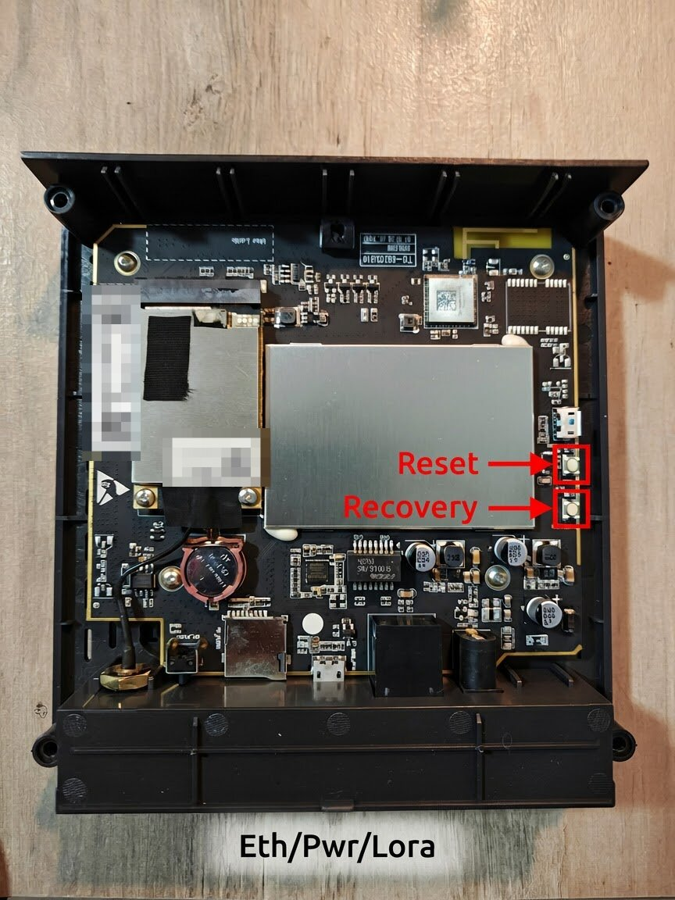
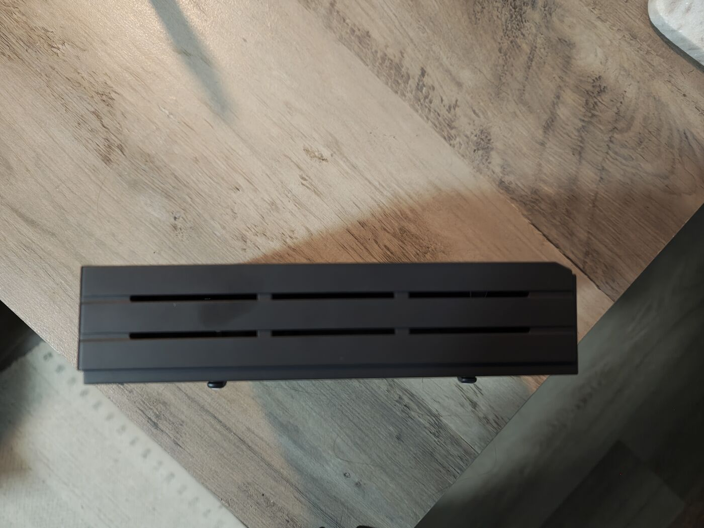
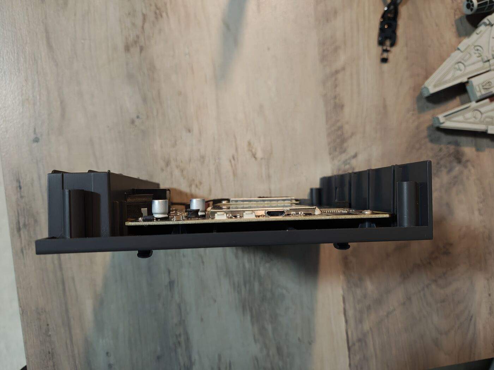

# Putting a Bobcat 300 into recovery mode

Recovery mode is how the [web flasher](https://bobcat.galaxyone.space/) (and `rkdeveloptool`) reaches the unit over USB.
You do not need to open the case: the two buttons can be pressed through the slots in the side of it.

You need:

- the unit's **power adapter**,
- a **micro-USB data cable** (many cables only charge; if nothing shows up on your computer, try another one),
- a computer with a USB port,
- something **small and thin** to press the buttons: a straightened paper clip, a lock pick, or a stiff strip of folded paper.

## The steps

1. **Power the unit.** Plug in the power adapter.
2. **Connect the USB cable.** Plug the micro-USB cable into the unit's micro-USB port labelled **COM**, which is next to the
   LoRa connector at the connector end of the case (it is not in the photos below), and the other end into your computer.
   Other micro-USB ports on the board, such as the one visible in the photo below, are not used for this.
3. **Hold the Recovery button** down. Keep holding it.
4. **While still holding Recovery, quickly press and release Reset.**
5. **Keep holding Recovery for about two seconds more**, then let go.

The unit restarts, and your computer should now see a new USB device. See [how to tell it worked](#how-to-tell-it-worked).

Pressing **Reset on its own** just reboots the unit. If you let go of Recovery before Reset has been pressed, or never held it
at all, the unit boots normally; try again.

## Finding the buttons

The buttons are two small tactile switches on the right-hand edge of the board **when you face the power connector** (the
end of the case with the Ethernet, power and LoRa antenna connectors). **Reset** is the upper one and **Recovery** is the
lower one, nearer the connectors.



*The board with the cover off, connector end at the bottom. Reset and Recovery are on the right-hand edge. The micro-USB
port you connect to is labelled **COM** and sits next to the LoRa connector; it is not in this photo. (The micro-USB port visible
at the bottom edge, between the SD card slot and the Ethernet jack, is a different one.)*

### With the cover on

With the cover on, the buttons can be pressed by pushing your thin tool through the **slots in the right-hand side of the
case**, as seen when facing the power connector.



*The side of the case with the slots.*



*A side view of the board in the case: the buttons sit right at the edge of the board, so a thin tool reaches them through
the slots. Push gently until you feel a click; they are small switches and need very little force.*

You will probably need to feel around for each button the first time. If you are not sure which one you pressed, press the
one you think is **Reset** on its own: the unit will reboot. The other one is Recovery.

## How to tell it worked

On your computer the board shows up as a USB device with vendor ID `2207` and product ID `350a`.

| What you see | Meaning |
|---|---|
| `2207:350a`, product name **"USB download gadget"**, `bcdDevice 0223` | **U-Boot download mode.** This is what a unit that already runs the community image shows. The web flasher can use it directly. |
| `2207:350a` with **no product name**, `bcdDevice 0100` | **Maskrom**, the chip's built-in mode. A unit that still has the factory firmware shows this. The web flasher sends it a small loader first, then carries on. |
| `2207:350a`, product name `USB-MSC` | A loader is running (Maskrom after the loader stage). Normal during a flash. |
| nothing | Not in recovery mode. See below. |

**Linux:**

```
lsusb -d 2207:350a                    # present?
cat /sys/bus/usb/devices/*/bcdDevice  # 0223 = download mode, 0100 = Maskrom
```

Chrome and Edge also need permission to open the device. Add a udev rule, for example in `/etc/udev/rules.d/99-bobcat.rules`:

```
SUBSYSTEM=="usb", ATTR{idVendor}=="2207", MODE="0666"
SUBSYSTEM=="usb", ATTR{idVendor}=="18d1", ATTR{idProduct}=="4d00", MODE="0666"
```

**Windows:** the device needs the WinUSB driver (for example installed with Zadig), or the browser cannot open it.

**macOS:** usually works without anything extra.

In the web flasher, press **Connect** and choose the device named *USB download gadget* (or the one with no name, for a
factory unit).

## If nothing shows up

- Try a **different USB cable**. A charge-only cable is the most common cause.
- Make sure the cable is in the micro-USB port labelled **COM** (next to the LoRa connector), and try a different USB port on the computer.
- Repeat the steps with a firmer, more deliberate timing: Recovery held *before* Reset is pressed, and kept held for about two
  seconds *after* Reset is released.
- **Power-cycle** the unit (unplug the power, wait five seconds, plug it back in) and start again from step 1.
- Check which mode you actually got (table above). A device with no product name is not a failure: that is Maskrom.

## Getting back to normal

Recovery mode does not change anything by itself. To leave it, press **Reset** on its own or power-cycle the unit. If a flash
completed, the unit boots into the new system.

## For reference

- From U-Boot's download mode, a unit can be sent back to Maskrom with `rkdeveloptool rd 3`.
- More about what the two modes can and cannot do, and why the flasher works in two phases: [`usb-flashing.md`](usb-flashing.md).
- Rescuing a unit whose bootloader is damaged: [`maskrom-recovery.md`](maskrom-recovery.md).
